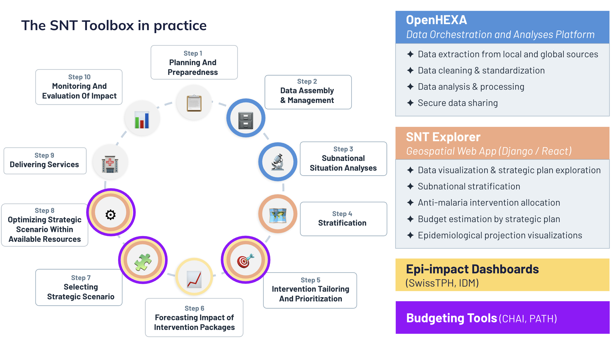
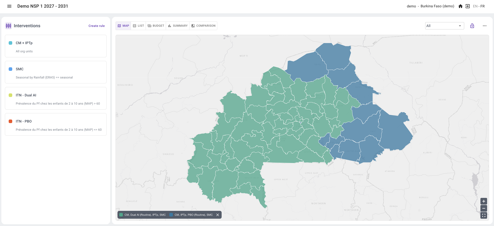

<!-- Generated from the Claude Doc "SNT Toolbox documentation", tab "What the toolbox does". Do not edit here. -->

# What the toolbox does

This page describes which parts of the SNT process the toolbox covers, from data assembly to costed scenarios, and which it does not. It is organised around the questions most often asked by programmes and partners.

## The SNT process and the toolbox

OpenHEXA covers data assembly and analysis (WHO SNT steps 1–3). SNT Explorer covers situation analysis maps, stratification, intervention targeting, budgeting and scenario comparison (steps 3–8). Impact forecasting (step 6) comes from modelling partners and is shown in SNT Explorer.

## What data goes in, and how does it get there?

There are two entry points. Either you generate the SNT data yourself with the OpenHEXA pipelines, from national and global sources. Or you already have data and analyses, and upload them as layers in SNT Explorer, the decision-making platform.

## How do I generate SNT data myself with OpenHEXA?

Everything starts with one extraction pipeline that pulls routine data from DHIS2 (HMIS or NMDR), together with the health pyramid (facility list and admin hierarchy), boundary files and population data. This first step provides the admin units and boundaries that all other analyses rely on, so it is always run first. The other pipelines then add global data (WorldPop, MAP, ERA5, DHS/MIS surveys) and map them onto the same pyramid and boundaries automatically. The table below lists the data used, where each comes from and how it enters the toolbox.

| Data | Source | Enters through | Updated |
| --- | --- | --- | --- |
| Routine malaria data (cases, tests, treatments, by facility and month) | DHIS2 (HMIS) or NMDR | Extraction pipeline | Monthly, can be scheduled |
| Health pyramid and boundaries | DHIS2 or NMDR; country boundary files | Extraction pipeline | When the pyramid or boundaries change |
| Population | National estimates, WorldPop | Population pipeline | Yearly |
| Rainfall | ERA5 | Rainfall pipelines | When new data are released |
| Modelled prevalence and other indicators | Malaria Atlas Project (MAP) | MAP pipeline | When MAP releases new estimates |
| Survey indicators (prevalence, coverage) | DHS / MIS | DHS pipeline | When a new survey is published |
| Your own analyses (e.g. SNT indicators, NSP or GC8 strata, entomology, costing data) | Programme or partners | Upload in SNT Explorer | Whenever you need |
| Impact model outputs | Modelling partners (currently Swiss TPH) | Upload in SNT Explorer | Per modelling round |

Every pipeline writes its output to a versioned dataset in one standard format. Routine data are stored in long format: year, month, admin unit, facility, indicator, value, with standard indicator codes. This lets each pipeline use the previous one's output, and lets SNT Explorer read the results directly.

The code of the SNT pipelines is open and available on GitHub: [BLSQ/snt\_development](https://github.com/BLSQ/snt_development/tree/main).

## Where is data checked and cleaned?

In OpenHEXA. The pipelines detect outliers, compute facility reporting rates and adjust incidence for incomplete reporting and care-seeking, before any indicator reaches SNT Explorer. At each of these steps, users choose a method (for example, one of several outlier detection methods) and set its parameters before running the pipeline.

Each pipeline run produces a report in OpenHEXA. Users check the results there, and can rerun with other settings if something looks wrong. Outputs are versioned, so earlier results are kept.

The pipelines produce these indicators: population estimates, facility reporting rates, crude and adjusted incidence, case seasonality, rainfall seasonality, DHS and MAP indicators, access to care and quality of care.

Data already cleaned outside the toolbox can skip this step and be uploaded directly into SNT Explorer.

## How flexible is it, and is it a black box?

The toolbox is not a black box.&#32;

The code of each pipeline is visible in the OpenHEXA workspace, each run produces a report, and each output is stored as a versioned dataset that can be opened and downloaded. The user chooses the method at each step. OpenHEXA offers three levels of control over the data analysis:

1. **Menus, no code.** A web app in OpenHEXA guides programme officers through the pipelines. They pick the outlier method, reporting-rate method, population scaling and seasonality thresholds from menus.
2. **AI assistants.** Analysts describe what they need, and an assistant creates a new pipeline or changes an existing one and adds it to the workflow. Changes apply only after the user accepts them.
3. **Your own scripts.** Analysts can control OpenHEXA from a local RStudio: pull datasets, continue in their own scripts, and push results back. Or they can skip the pipelines and upload their results into SNT Explorer.

In SNT Explorer, the user has the same control over the planning decisions: the steps and thresholds of composite risk layers, the eligibility rules and priorities of each scenario, and every cost value, from unit costs to conversion factors. Beyond the cost formula, nothing is fixed by the tool.

## Where do I do risk stratification?

In SNT Explorer. The indicators (incidence, prevalence, seasonality and others) come from the OpenHEXA pipelines or are uploaded by the user. Risk stratification is done with composite layers, built in a visual node editor: each indicator is normalized or classified with thresholds, and the results are combined into one risk score or risk class per district. A composite layer can also be built by describing it to the AI assistant.

See [3. Creating composite risk scores](./creating-composite-risk-scores.html).

## Where do I target interventions and design scenarios?

In SNT Explorer, by building scenarios (see [6. Building a scenario](./building-a-scenario.html)).

For each intervention, users set the rules that make a district eligible: which indicators, which thresholds, and how they combine. Rules can be combined, for example urban districts plus a prevalence threshold. The map updates as rules change, and each set of rules is saved as a scenario.

An AI assistant can help build the plan. Users describe the rules in plain language, or upload documents such as the NSP, GC8 documents or the WHO SNT manual, and the assistant proposes scenario rules that the user reviews and adjusts. It can also help import existing NSP or GC8 scenarios into SNT Explorer, so they can be compared with new ones.

## How are costs calculated?

Each cost line item, for each intervention and district, is calculated from five elements:

**Cost = Target population × Target scale × Conversion factor × (1 + Buffer) × Unit cost**

| Element | What it is | Example (ITN campaign) |
| --- | --- | --- |
| Target population | The population the line applies to, per district and year | 100,000 people (total population) |
| Target scale | The share of the target population to reach | 100% |
| Conversion factor | Number of units per person | 1.8 persons per net, inverted (0.56 nets per person) |
| Buffer | Extra quantity for wastage or contingency | 10% |
| Unit cost | Cost of one unit | $3.49 per net |

In this example the district needs 100,000 × 1 × 1/1.8 × 1.1 = 61,111 nets, at a cost of $213,278. Setting up the budget gives the full explanation and more examples.

Costs update automatically when the intervention mix changes. Each intervention can have as many line items as needed (procurement, distribution, training, down to refreshments at a training), and fixed costs can be added.

## Where do impact estimates come from?

From modelling partners, currently Swiss TPH. The toolbox does not run impact models itself. Model outputs (cases, severe cases, prevalence reduction) are uploaded into SNT Explorer, where users compare scenarios side by side on impact and cumulative cost.

## What the toolbox does not do yet

We keep this list with programmes and partners, and update it as requests come in.

- **Impact modelling.** Projections still come from modelling partners. We are exploring how AI could support this in the coming years.
- **Analysis below Admin-2 ****level.** Analyses at health area or facility level are close to ready. Maps at that level depend on the country having reliable boundaries for those units.
