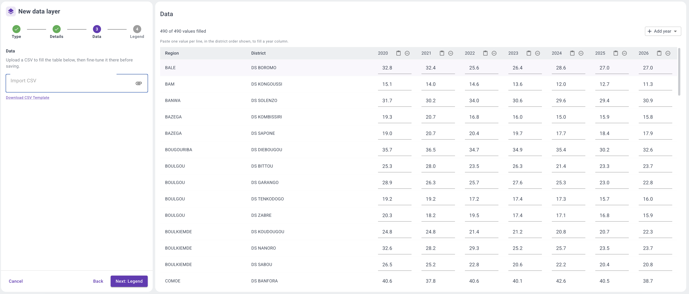
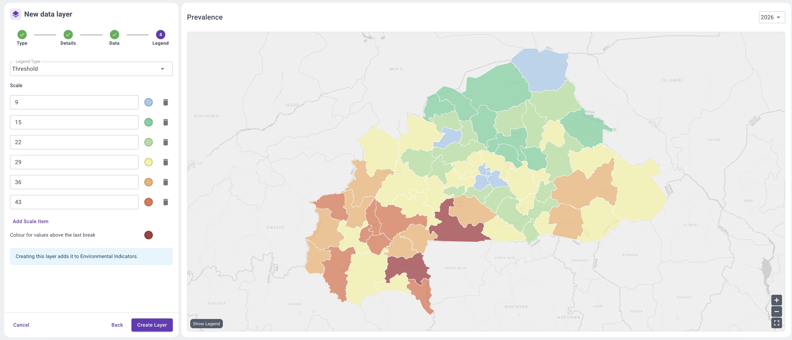
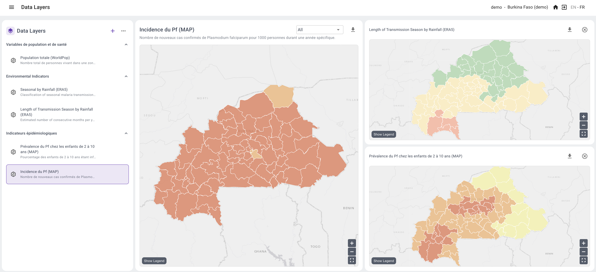

<!-- Generated from the Claude Doc "SNT Toolbox documentation", tab "2. Importing and reviewing data". Do not edit here. -->

# 2. Importing and reviewing data

Data enter SNT Explorer as data layers, one layer per indicator. There are three ways to load a layer:

- **Manual import.** Upload a CSV file with the values of one indicator.
- **From OpenHEXA.** When an OpenHEXA workspace is set up and linked to the SNT Explorer account, the pipeline outputs are loaded as layers (see [1. Data orchestration and analysis](./data-orchestration-and-analysis.html)).
- **Composite layer.** Combine existing layers in the visual node editor (see [3. Creating composite risk scores](./creating-composite-risk-scores.html)).

This page covers the manual import.

## Manual data import

### One layer at a time

Import the data layer by layer: one CSV file per indicator, with one column per year. A layer can hold a single year or several; more years let users pick the data year in scenarios and compare years.

The data do not need to be prepared by hand. Give an AI assistant such as Claude the CSV template (step 4 below) together with your existing Excel files, and ask it to put the data in the template format. The steps below then create the layer.

### Create the layer

1. In the **Data Layers** panel, click **+** (Create layer).
2. **Type.** Choose *Standard data layer*, for data from a CSV file.
3. **Details.** Enter a name, a data key and a category; description, units and unit symbol are optional. The category is the group the layer appears in. Tick *Is population* if the layer holds target population estimates and needs to be used for calculating budgets.
4. **Data.** Download the CSV template, fill it in (or ask Claude/ChatGPT to do it for you) and import it. The table then shows the values per district and year, and how many are filled. Values can still be corrected in the table, pasted per year column, or completed with an extra year (*Add year*).

5. **Legend.** Choose the legend type (for example *Threshold*), then set the breaks and colours. The map on the right previews the layer, by year. Click **Create layer** to add it to its category.

Three legend types are available:

| Type | Use |
| --- | --- |
| Threshold | Groups values into classes (e.g. 0–20%, 20–40%, etc.) |
| Ordinal | Groups non-numeric or fixed values (e.g. low, medium, high, or 1, 2, 3) |
| Linear | Shows values on a continuous colour gradient between a minimum and a maximum |

## Reviewing the data

Click a layer in the **Data Layers** panel to show it on the main map. To compare layers, click the **+** next to a layer: it is added as a smaller map on the right, so several layers can be viewed side by side. In the screenshot below, Pf incidence is on the main map, with the length of the transmission season and Pf prevalence next to it. Each map can be downloaded.

To change how a layer is shown, click the three dots (⋯) next to it and edit its legend: breaks, colours and legend type, as in the Legend step when creating a layer.

