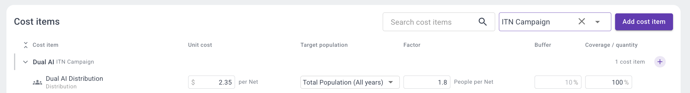
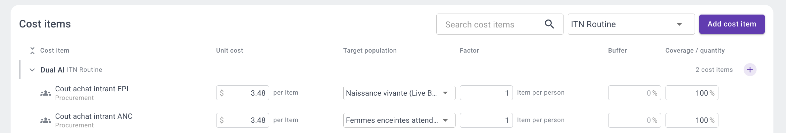
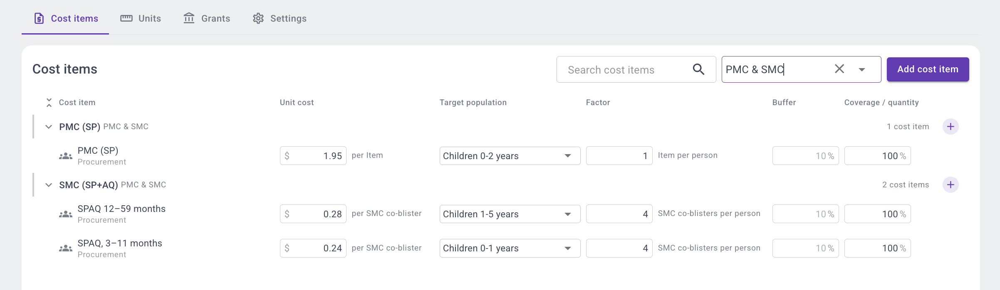

<!-- Generated from the Claude Doc "SNT Toolbox documentation", tab "5. Setting up the budget". Do not edit here. -->

# 5. Setting up the budget

The budget of a scenario is calculated in SNT Explorer from the interventions assigned to each district. Each intervention has one or more cost lines. A single line with a rough total unit cost gives a ballpark estimate; a detailed breakdown can be added later, depending on the stage of the planning process and the level of detail needed. A cost line is either **population-based**, and then costed per district from a target population, or **fixed,** and then costed once for the scenario. The budget is recalculated whenever the scenario is updated.

Cost lines are grouped in five categories: procurement, distribution, operational, supportive and other.

## Global settings and scenario overrides

The budget is set up on the cost management page, after the interventions. The settings there are global: they apply to every scenario in the account. Scenarios can be built at any time, but a scenario only gets a budget for interventions that have cost lines here.

On this page you define the budget settings (currency, exchange rate, inflation, default buffer), and the cost lines of each intervention with their national default values.

Within a scenario, cost line values can then be overridden per rule, for the districts that rule targets, down to the conversion factor. This is how costs differ between areas: for example a higher distribution cost in hard-to-reach districts, or nets distributed at 2.2 instead of 1.8 persons per net. Overrides only affect that scenario. How to set them, and the years an intervention is deployed, is explained in [6. Building a scenario](./building-a-scenario.html).

## The cost formula

For a population-based cost line, the quantity and cost in a district and year are:

**Quantity = Target population × Target scale × Conversion factor × (1 + Buffer)**

**Cost = Quantity × Unit cost × (1 + Inflation) ^ (year − start year)**

| Element | What it is | How to set it |
| --- | --- | --- |
| Target population | The population the line applies to, per district and year. | Choose a population layer: total population, children under 5, pregnant women, households, etc. The layer must have values for each year of the scenario. |
| Target scale | The share of the target population to reach, in %. | Enter a percentage, e.g. 100% for a campaign, 80% for routine distribution. |
| Conversion factor | Number of units per person (or per unit of the target population). | Enter the number of units per person, e.g. 3 doses of IPTp per pregnant woman. When it is easier to express as persons per unit, enter that number and tick *invert*: 1.8 persons per net gives 1 / 1.8 = 0.56 nets per person. For costs per person reached, set it to 1. |
| Buffer | Extra quantity for wastage or contingency, in %. | Enter a percentage per cost line. If left empty, the default buffer of the budget settings applies (10% unless changed). |
| Unit cost | Cost of one unit (one net, one blister pack, one training day). | Enter the cost in the budget currency, taken from the NSP costing or the grant quantification. |
| Inflation | Yearly increase applied from the start year of the scenario. | Set once in the budget settings. |

The buffer is applied to the quantity, not only to the cost. The quantities shown in SNT Explorer are therefore the quantities to procure.

## Fixed costs

A fixed cost line does not depend on population. Instead of a target population and target scale, you enter the quantity per year (for example 50 training days). The conversion factor is not used.

**Cost = Quantity per year × (1 + Buffer) × Unit cost × (1 + Inflation) ^ (year − start year)**

Fixed costs are counted once per scenario and year, not per district. They are only counted when the intervention is assigned to at least one district, and only in the years it is deployed. If several rules assign the same intervention, the values of the rule with the highest priority are used.

## Example 1: ITN mass campaign

One cost line per net, using a real unit and the number of people per net as conversion factor. Example for a district of 100,000 people.

| Setting | Value |
| --- | --- |
| Unit | Net |
| Unit cost | $2.35 per net |
| Target population | Total population |
| Conversion factor | 1.8 people per net (inverted: 0.56 nets per person) |
| Buffer | 10% (default) |
| Target scale | 100% |
| Quantity | 100,000 × 1 × 1/1.8 × 1.1 = 61,111 nets |
| Cost | $143,611 |

Set the deployment years of the rule to the campaign years (e.g. 2027 and 2030), so the campaign is only costed in those years.

## Example 2: Routine ITN distribution, as a ballpark estimate

When detailed costing is not yet available, a cost line can use a generic unit (*Item*) with a conversion factor of 1: the unit cost is then simply the cost per person reached. Routine nets are distributed through two channels, each with its own target population.

| Setting | EPI channel | ANC channel |
| --- | --- | --- |
| Unit | Item | Item |
| Unit cost | $3.48 per item | $3.48 per item |
| Target population | Live births | Pregnant women attending ANC |
| Conversion factor | 1 item per person | 1 item per person |
| Buffer | 0% | 0% |
| Target scale | 100% | 100% |

For a district with 4,000 live births, the EPI line costs 4,000 × 1 × 1 × $3.48 = $13,920. The estimate can be refined later, for example with separate lines for procurement and distribution.

## Example 3: SMC and PMC

For SMC, the unit is the real commodity, the SPAQ co-blister, and the conversion factor is the number of cycles: one co-blister per child per cycle. Each age group has its own line, because dose and price differ. PMC is costed per child as an item, in the same category as SMC so that a district receives one or the other.

| Setting | SPAQ 12–59 months | SPAQ 3–11 months | PMC (SP) |
| --- | --- | --- | --- |
| Unit | SMC co-blister | SMC co-blister | Item |
| Unit cost | $0.28 | $0.24 | $1.95 |
| Target population | Children 1–5 years | Children 0–1 years | Children 0–2 years |
| Conversion factor | 4 (cycles) | 4 (cycles) | 1 |
| Buffer | 10% (default) | 10% (default) | 10% (default) |
| Target scale | 100% | 100% | 100% |

For 20,000 children aged 1–5 years: 20,000 × 1 × 4 × 1.1 = 88,000 co-blisters, costing $24,640.

Where the number of cycles differs between areas (3, 4 or 5), set the conversion factor in each rule in the scenario page rather than on the cost line. A rule for districts with a longer season can then use 5 cycles, while another uses 4.

## Example 4: Malaria vaccine (R21)

The unit is the vaccine dose. The four-dose schedule is split over two lines by age: three doses in the first year of life and the fourth dose in the second.

| Setting | R21 infant | R21 child |
| --- | --- | --- |
| Unit | Vaccine dose | Vaccine dose |
| Unit cost | $2.99 | $2.99 |
| Target population | Children 0–1 years | Children 1–2 years |
| Conversion factor | 3 doses per person | 1 dose per person |
| Buffer | 10% (default) | 10% (default) |
| Target scale | 100% | 100% |

For 5,000 infants: 5,000 × 1 × 3 × 1.1 = 16,500 doses, costing $49,335.

## Example 5: a fixed cost

A training of trainers before the SMC campaign: 25 participants for 4 days, at $60 per participant-day.

| Setting | Value |
| --- | --- |
| Type | Fixed |
| Unit | Day |
| Unit cost | $60 |
| Quantity per year | 100 (25 participants × 4 days) |
| Buffer | 0% |
| Cost in the start year | 100 × $60 = $6,000 |
| Cost one year later, with 5% inflation | $6,000 × 1.05 = $6,300 |

The training is costed once for the scenario, whatever the number of districts receiving SMC.

## Grants and donors

Donors and their grants (with the grant amount) are entered in SNT Explorer. Each intervention can be linked to a grant, and a rule can link its interventions to another grant. The budget can then be shown by grant and year, next to the grant amount. Costs not linked to any grant are grouped as unspecified.
