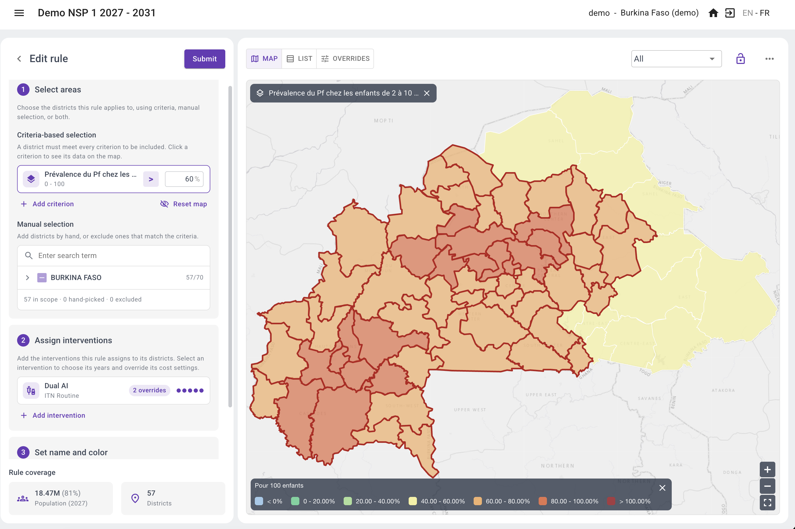
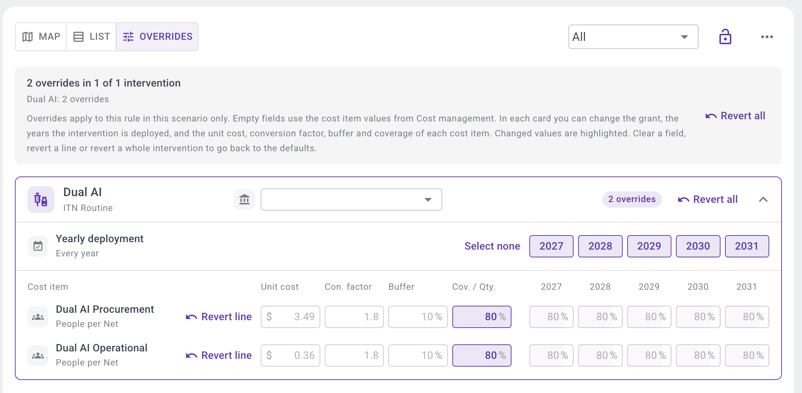
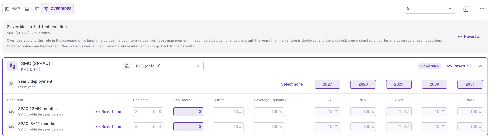
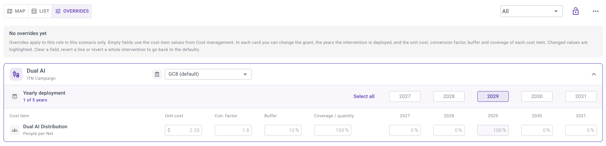
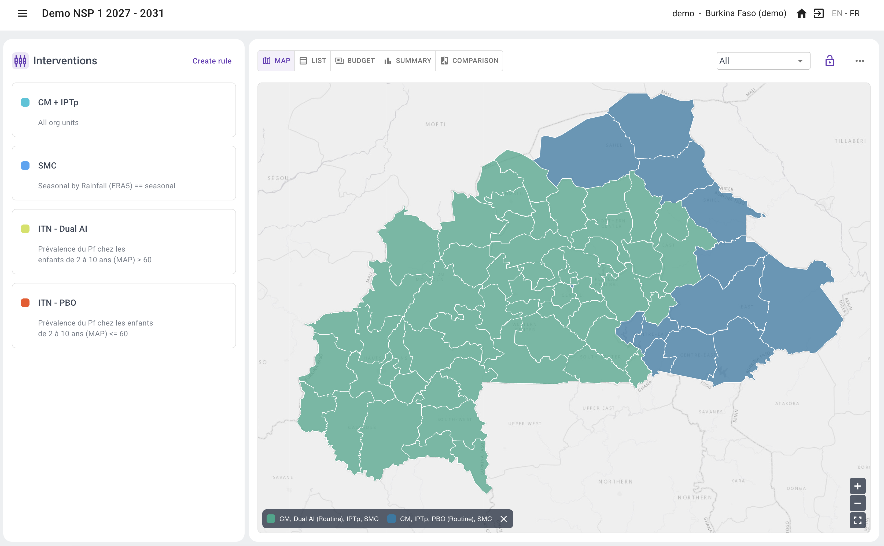
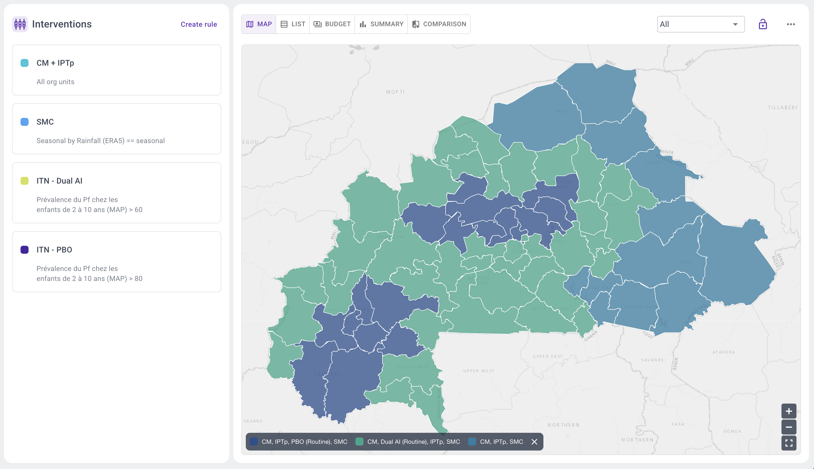
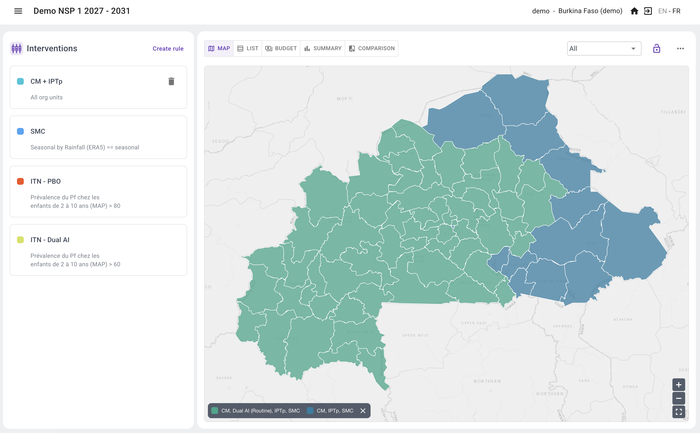
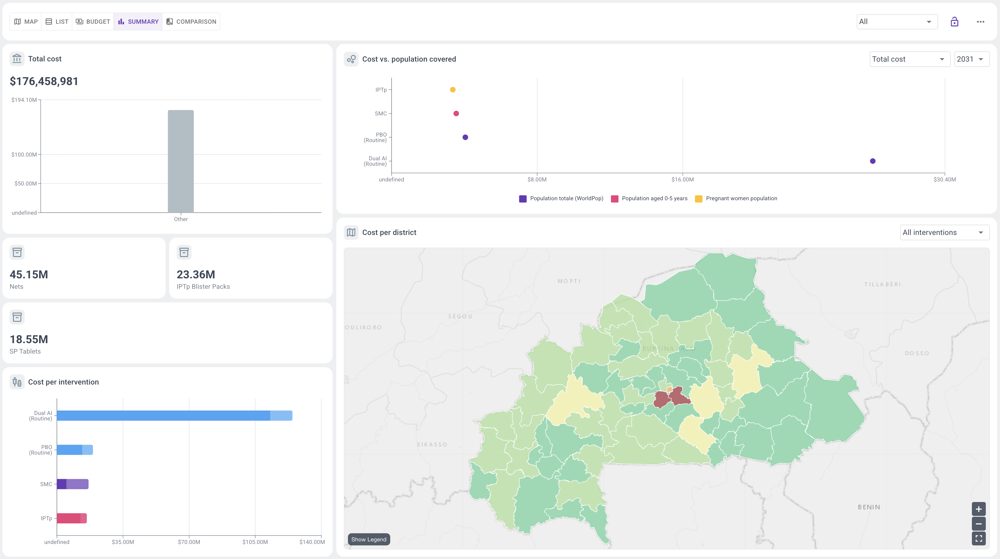

<!-- Generated from the Claude Doc "SNT Toolbox documentation", tab "6. Building a scenario". Do not edit here. -->

# 6. Building a scenario

A scenario is a combination of interventions assigned to districts over a period of years. In SNT Explorer, a scenario is built from rules: each rule selects districts, using indicator criteria or a manual selection, and assigns one or more interventions to them. The map and the budget update with every change.

## Scenarios in the SNT process

In the WHO SNT manual (2025), scenarios are developed in step 5 (intervention tailoring and prioritization). Their impact is forecast in step 6, one is selected as the strategic scenario in step 7, and it is optimized within the available resources in step 8. The manual describes three kinds of scenarios, each built as a separate scenario in SNT Explorer:

| Scenario | What it contains | How to build it in SNT Explorer |
| --- | --- | --- |
| Business as usual | The current strategy (NSP, GC8), used as reference | Import the current plan from a CSV file (one row per district, one column per intervention), or write rules that reproduce it |
| All eligible interventions | All interventions each district is eligible for, following WHO recommendations and national goals | One rule per intervention, with the eligibility criteria as conditions on indicators |
| Prioritized scenarios | Subsets of the eligible scenario that fit expected resources and operational feasibility | Duplicate the eligible scenario, then tighten criteria, remove interventions, or change deployment years and target scale |

The manual notes that the process is iterative: scenarios are refined as impact estimates and costs become available.

## Creating a scenario

A scenario has a name, a description, and a start and end year. The years set the period over which the budget is calculated. For each indicator used in the rules, you choose which year of data is used; changing that year updates the districts selected by the rules.

A scenario can be duplicated, to derive a prioritized version without changing the original, and locked once agreed, to prevent further changes.

## Writing rules

A rule is set up in the rule editor, in three steps: select the areas, assign the interventions, and give the rule a name and colour. How the interventions are deployed is then set in the Overrides view.

### Select areas

Districts are selected with criteria, by hand, or both. A district must meet every criterion to be included (for example PfPR > 10% and not urban). Numeric indicators are compared with a threshold; categorical layers, such as a composite risk class or an urban/rural layer, are compared with a value. Clicking a criterion shows its data on the map. Districts can then be added by hand, or excluded even if they match the criteria. The editor shows the population and number of districts the rule covers.

### Assign interventions

Add one or more interventions to the rule, at most one per category. They are assigned to all districts the rule selects.

### Set how the interventions are deployed

In the Overrides view, each intervention of the rule has its own card. There you choose the grant that funds it and the years it is deployed. For each cost item you can also change the unit cost, conversion factor, buffer and coverage, for all years or for a single year. Empty fields use the values from cost management, and changed values are highlighted. Overrides apply to this rule in this scenario only, and can be reverted per line or per intervention (see Setting up the budget).

**Example: lower coverage for routine nets.** In cost management, the Dual AI routine lines have a coverage of 100%. For this rule, coverage of both the procurement and operational lines is lowered to 80%, for all years. The overridden fields are highlighted; the other values still come from the global cost settings.

**Example: SMC with 3 cycles.** In cost management, the SPAQ lines use 4 co-blisters per child (4 cycles). In this scenario, SMC is planned with 3 cycles, so the conversion factor of both SPAQ lines is overridden to 3 for this rule. The changed values are highlighted, and *Revert line* brings back the default.

**Example: a campaign once every three years.** Under *Yearly deployment*, clicking a year toggles it on or off. Here the Dual AI campaign is only deployed in 2029, so it is costed in 2029 and coverage is 0% in the other years of the plan.

## Rule priority and overlapping rules

The order of the rules in the scenario's rule list sets their priority. To change it, simply drag a rule up or down the list. A rule lower in the list has a higher priority: where rules overlap, it overrides the rules above it. When a district is selected by several rules:

- interventions from different categories are all applied;
- for interventions from the same category, only the one from the rule with the highest priority is applied in that district. The lower-priority rule still applies in the other districts it selects.

The three screenshots below show this with two rules for routine ITNs, whose net types are in the same category:

1. **No overlap.** Dual AI nets where PfPR is above 60%, PBO nets where it is 60% or below. Each district matches only one rule, so the order does not matter: every district receives one net type.

2. **Overlap, PBO overwrites Dual AI.** The Dual AI rule (PfPR above 60%) is above the PBO rule (PfPR above 80%). Dual AI is first assigned to all districts above 60%; the PBO rule, lower in the list, then overwrites it where PfPR is above 80%. Result: PBO nets above 80% and Dual AI nets between 60% and 80%.

3. **Overlap, Dual AI overwrites PBO.** The same rules, with the PBO rule dragged above the Dual AI rule. PBO is first assigned to districts above 80%; the Dual AI rule, now lower in the list, then overwrites it in all districts above 60%. Result: Dual AI nets in every district above 60%, no PBO nets anywhere, and no routine nets at 60% or below.

## Fine-tuning beyond eligibility

Eligibility criteria give a first version of a scenario. Programmes then adjust it to operational and programmatic considerations, which the WHO manual raises in steps 5 to 8:

- **Adding or removing districts by hand.** For example, adding a district with a large displaced population to the ITN rule, or removing a district where IRS is ongoing and should continue.
- **Deployment years (Tab Overrides)****.** An ITN campaign every three years, a phased introduction of the malaria vaccine, or an intervention that stops after a given year.
- **Target scale and costs per rule (Tab Overrides)****.** For example, lower coverage in a first year of introduction, or a higher distribution cost in hard-to-reach districts.
- **Changing the data year** of an indicator, to see how the selection changes with more recent data.
- **Testing alternatives in a duplicate scenario.** The manual lists typical questions, such as whether to scale back ITNs in urban areas, or whether to choose SMC or the malaria vaccine where a district is eligible for both and resources do not allow both.

## Using the AI assistant

Rules can also be written by describing them in plain language, for example "SMC with 4 cycles in non-urban districts with PfPR above 10%". The assistant knows the account's indicators, interventions and grants, and proposes a set of rules with conditions, interventions, deployment years and cost values. Check the proposed rules and the resulting map before using the scenario.

The assistant can also build a scenario from WHO recommendations. For example, ask it to reproduce the illustrative implementation scenario for Country X in the WHO SNT manual: next-generation ITNs, IRS, SMC, PMC, IPTp and the malaria vaccine, each with its eligibility thresholds. It translates these into rules on the account's indicators and sets priorities so that, for instance, IRS replaces the net campaign and SMC replaces PMC where both apply. Thresholds still need to be checked against the national context.

## Comparing and exporting scenarios

Scenarios are compared side by side on their intervention maps, budgets and, where model outputs are available, modelled impact (cases, severe cases, prevalence reduction, cumulative cost). A scenario can be exported as a CSV file with one row per district and one column per intervention.

